<!--
  Save the generated SVG banner as `banner.svg` in your repository root
  and reference it below!
-->

<p align="center">
  
</p>

<p align="center">
  <a href="https://github.com/Anany-De">
    
  </a>
  <a href="https://tryhackme.com/p/ananysha941">
    
  </a>
  
  
</p>

---

## 🎯 Operator Profile

> **Location:** Agra, Uttar Pradesh, India `[27.1767° N, 78.0081° E]`  
> **Clearance:** Level 1 Certified Red Team Emulation Lead & GRC Analyst

<details open>
<summary><b>🔴 Red Team Mode (Default) — Offensive Security & Red Team Specialist</b></summary>
<br/>
Specializing in wireless penetration testing, network packet analysis, and adversarial emulation. Proven track record in LLM security, Red Team operations, and building custom Python/Bash security automation across 68+ GitHub repositories.
</details>

<details>
<summary><b>🛡️ GRC Mode — Cybersecurity Governance, Risk & Compliance Analyst</b></summary>
<br/>
Bridging offensive technical insight with enterprise risk management, security training delivery, and AI/LLM security governance—translating complex technical threats into actionable compliance frameworks (NIST CSF, ISO 27001).
</details>

---

## 📈 Git Telemetry & Activity Matrix

<p align="center">
  
  
</p>

<p align="center">
  
</p>

---

## 📊 Operational Telemetry

| Metric | Value | Details |
| :--- | :--- | :--- |
| **Repo Intelligence** | `68+ Repos` | Open-Source Tooling, CLI Scanners & CVE Exploits |
| **AI Defense Metric** | `86% Cert` | LLM Jailbreak & Prompt Injection Defense |
| **Operational Clearance** | `Level 1 Lead` | Certified Red Team Emulation Practitioner |
| **Offensive Benchmark** | `Top 1%` | TryHackMe & PortSwigger Global Ranking (150+ Labs) |

---

## 🛠️ Core Arsenal & Tooling

**Penetration & Packet Sniffing**  


**Web, Binary & SecOps Scripting**  


---

## 🚀 Deployed Operations & Security R&D

| Operation | Domain | Summary |
| :--- | :--- | :--- |
| **AI & LLM Security Operations** | `LLM Security` `Prompt Injection` `Red Teaming` | Adversarial testing and security evaluation of Large Language Models, focusing on jailbreak resilience and local LLM workstation deployment. |
| **Automated Recon & Packet Forensics** | `Python` `Bash` `Wireshark` `Nmap` | Custom CLI tooling and scripts built across 68+ repositories to automate network enumeration, wireless packet capture analysis, and log forensics. |
| **Adversarial Lab & CTF Research** | `TryHackMe` `PortSwigger` `Linux` | Documented exploitation methodologies covering web application vulnerabilities, privilege escalation, and network intrusion scenarios. |

---

## 📡 Recon & Intelligence Feeds

- **GitHub Matrix:** [github.com/Anany-De](https://github.com/Anany-De)
- **TryHackMe Profile:** [tryhackme.com/p/ananysha941](https://tryhackme.com/p/ananysha941)
- **LinkedIn Network:** [linkedin.com/in/anany-sharma2001](https://linkedin.com/in/anany-sharma2001)

---

```text
> STATUS: Available for Security Roles & Audits
> EMAIL : ananysha941@gmail.com
> PHONE : +91 9359990203
> GPG   : 4A7B 89C1 E0F3 29D8 12BC 88F4 AA91 C237 0F99 7049
```
